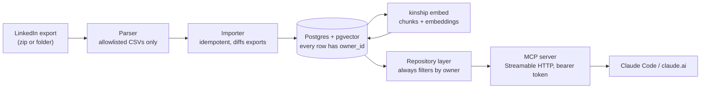

# Kinship

Your LinkedIn network, available to AI assistants.

Kinship loads a LinkedIn data export into Postgres and serves it through a
remote [Model Context Protocol](https://modelcontextprotocol.io) server. An
assistant can ask who you know at a company, rank warm introduction paths, see
what changed between two exports, and search your recommendations and work
history to tailor a job application.

**Status:** working prototype. Ingest, the MCP server and its tools, and the
retrieval layer are built and tested against synthetic data. Hosting is not
done yet: the Fly.io deploy
([#14](https://github.com/naryga/kinship/issues/14)) and the claude.ai
authentication spike ([#13](https://github.com/naryga/kinship/issues/13)) are
open. The design is in [docs/DESIGN.md](docs/DESIGN.md).

This repository contains no real LinkedIn data. Tests, the demo below and the
evaluation all use a synthetic export produced by `kinship synth`.

## Architecture



| Stage | Where | What it does |
|---|---|---|
| Parse | `src/kinship/parser/` | Reads only the files on the allowlist in [docs/linkedin-export-format.md](docs/linkedin-export-format.md); handles preambles, split files, mixed date formats and differently named profile-URL columns. |
| Import | `src/kinship/ingest/` | One transaction per export. The same file twice is a no-op; exports can arrive in any order and the database ends up the same. Job changes go to `connection_history`; a missing connection gets `removed_at` and is never deleted. Company spellings are grouped ("Acme", "Acme, Inc.", "ACME Corp"). |
| Index | `src/kinship/rag/` | One chunk per recommendation, position and profile. Message bodies are embedded only with `--include-messages`. Only new or changed chunks are embedded. |
| Read | `src/kinship/repo/` | The only code that queries. Every statement is built from helpers that add the owner filter, and a second filter is applied to every owned table at execution time. |
| Serve | `src/kinship/server/` | The MCP server. It cannot import the database layer at all (a test enforces this); tools call the repository. |

## What an assistant can call

| Tool | Answers |
|---|---|
| `find_connections_at_company(company, include_former)` | Who do I know at this company, now or in the past? |
| `search_connections(query, title, company, limit)` | Find people by name, title or company. |
| `get_connection(name_or_url)` | One person: role history, last contact, endorsements, recommendations, notes. |
| `warm_paths(company, limit)` | Who is the best person to ask for an introduction, and why. |
| `network_changes(since)` | Job changes, new and removed connections between exports. |
| `semantic_search(query, sources, k)` | Hybrid retrieval over recommendations, positions and profile. |
| `match_job(description_text, ...)` | The parts of my history that fit a job description, and connections near the role. |
| `network_summary()` | Row counts and the latest import. |

There is also a resource, `kinship://imports/latest`, and a prompt,
`draft_intro_request(connection, job)`. All tools are read-only and run in a
read-only database transaction.

## Try it with synthetic data

You need [uv](https://docs.astral.sh/uv/) and a Postgres server with the
`pgvector` extension. `docker compose up -d db` starts one.

```
cp .env.example .env
uv sync
uv run alembic upgrade head

# Two fake exports of the same network, 18 months apart
uv run kinship synth data/export_v1 --version 1
uv run kinship synth data/export_v2 --version 2

uv run kinship import data/export_v1 --owner Demo --exported-at 2025-05-10T12:00:00Z
uv run kinship import data/export_v2 --owner Demo --exported-at 2026-11-02T12:00:00Z

# Offline embeddings for the demo; use --embedder openai with OPENAI_API_KEY for real ones
uv run kinship embed --owner Demo --embedder fake

KINSHIP_EMBEDDER=fake uv run kinship serve      # http://127.0.0.1:8000
```

`import` prints the owner id. `KINSHIP_TOKENS` in `.env` maps bearer tokens to
owner ids (`dev-token:1` by default). `--exported-at` is only needed for an
extracted folder; a zip carries its own date.

### Connect from Claude Code

```
claude mcp add --transport http kinship http://127.0.0.1:8000/mcp \
  --header "Authorization: Bearer dev-token"
```

### Connect from claude.ai

claude.ai reaches a custom connector over the public internet, so this needs
the hosted deployment ([#14](https://github.com/naryga/kinship/issues/14)).
Whether a claude.ai Project can send a static bearer token or needs OAuth is
the open question in [#13](https://github.com/naryga/kinship/issues/13); this
section will be filled in when that is settled.

### Example conversation

The answers below are what the tools return for the synthetic network (seed 42).
Every person and most companies are invented.

> **You:** Who do I know at Gift Health?
>
> **Assistant** *(calls `find_connections_at_company("gift health")`)*: You have
> 10 current connections there. The data spells the company three ways
> ("Gifthealth", "Gift Health, Inc.", "gift health") and Kinship treats them as
> one. They include Hattie Birchall (Billing Platform Engineer) and Quinn
> Copperpot (Machine Learning Engineer).
>
> **You:** Who should I ask for an introduction?
>
> **Assistant** *(calls `warm_paths("gift health")`)*: Quinn Copperpot is the
> warmest path (score 40): Quinn wrote you a recommendation in 2024, you exchanged
> 3 messages, and you endorsed Quinn for Feature Engineering. Casey Foxglove is
> next (37.3): a recommendation in 2023 and two endorsements from you.
>
> **You:** What changed in my network since the last export?
>
> **Assistant** *(calls `network_changes()`)*: Since 2025-05-10 there were 8 job
> changes (5 moved company, 3 changed title), 4 new connections and 3 removed.
> Elio Emberly moved from ACME Corp to Gifthealth as Senior UX Researcher.
>
> **You:** Which parts of my background show data pipeline work?
>
> **Assistant** *(calls `semantic_search("data pipelines airflow")`)*: Your Data
> Engineer role at Acme, Inc. (Jun 2018 to Feb 2022), where you built Airflow
> batch pipelines and dbt models, and Freya Rookwood's recommendation, which says
> you cut the nightly warehouse load from six hours to forty minutes.

## Using your own export

Request your data from LinkedIn (Settings → Data privacy → Get a copy of your
data), then:

```
uv run kinship import ~/Downloads/Basic_LinkedInDataExport_11-02-2026.zip --owner "Your Name"
uv run kinship embed --owner "Your Name"          # needs OPENAI_API_KEY
```

Keep the export outside the repository or under `data/`, which is gitignored
along with every `*.zip` and `*.csv` outside `tests/fixtures/`. An export holds
other people's data; it must never be committed. Files that are not on the
allowlist (ad targeting, logins, phone numbers and so on) are never opened.

To load a production database, run the same `import` command locally with
`DATABASE_URL` pointing at it.

## Retrieval evaluation

`semantic_search` is measured, not assumed. [`evals/golden.jsonl`](evals/golden.jsonl)
holds 24 queries over the synthetic export, each with the recommendations,
positions or profile that should come back: 8 exact-keyword queries, 8
natural-language questions that share some words with their target, and 8
paraphrases that share almost none (see [`evals/README.md`](evals/README.md)).

```
make eval                                # fake embedder, offline
make eval ARGS="--embedder openai"       # a real model; needs OPENAI_API_KEY
uv run kinship eval --help               # --k, --format markdown|json, --min-recall, ...
```

The command needs a source checkout and a Postgres server it may create
databases on (`DATABASE_URL`). It creates a throwaway database, migrates it,
imports the synthetic export, embeds it, runs the queries in each retrieval
mode and drops the database again. It never writes to an existing database.

- **recall@5**: the share of queries with at least one expected item in the top 5.
- **MRR**: the mean of 1 / (rank of the first expected item), over the top 20.

Results with the fake embedder (this is what CI runs; a test keeps this table
in step with the code):

<!-- eval-results:fake:start -->
Embedder: `fake-hash-v1` · 24 queries · recall@5 · MRR over the top 20

| Queries | n | Full-text recall@5 | Full-text MRR | Vector recall@5 | Vector MRR | Hybrid recall@5 | Hybrid MRR |
|---|---:|---:|---:|---:|---:|---:|---:|
| all | 24 | 0.75 | 0.75 | 0.75 | 0.70 | 0.75 | 0.75 |
| keyword | 8 | 1.00 | 1.00 | 1.00 | 1.00 | 1.00 | 1.00 |
| question | 8 | 1.00 | 1.00 | 1.00 | 0.92 | 1.00 | 1.00 |
| paraphrase | 8 | 0.25 | 0.25 | 0.25 | 0.19 | 0.25 | 0.25 |
<!-- eval-results:fake:end -->

Read these numbers for what they are. The fake embedder is a hashed bag of
words, a lexical stand-in for a real model, so here "vector" search finds what
full-text search finds and hybrid adds nothing. Both fail on the paraphrases,
which is the gap a real embedding model is there to close. The synthetic corpus
is also small (20 chunks, one topic each), so any query that shares a word with
its target is easy.

Results for `text-embedding-3-small` are not measured yet (no API key has been
used with this harness so far). Run `make eval ARGS="--embedder openai --format markdown"`
and add the table here; it embeds 20 short chunks and 24 queries, which costs a
fraction of a cent. The same command compares any other model behind the
`Embedder` protocol.

CI runs the harness with `--min-recall 0.65`, so a change that pushes hybrid
recall@5 below that fails the build.

## Design decisions

- **Owner scoping from day one.** v0 has one user, but every owned table carries
  `owner_id` and nothing reads a table except through a repository bound to one
  owner. Multi-user ([#16](https://github.com/naryga/kinship/issues/16)) then
  becomes an authentication change, with Postgres row-level security as a second
  guard, instead of a data migration.
- **Imports are replayable.** Each import records what it saw
  (`connection_sightings`), and the current state, removals and role history are
  derived from those records. That is what makes import order irrelevant.
- **One database.** Postgres does the relational queries, full-text search and
  vector search (pgvector with an HNSW index), so hybrid retrieval is one query
  plan away from the rest of the data. Results are merged with reciprocal rank
  fusion.
- **Embeddings behind a protocol.** `text-embedding-3-small` is the default;
  tests and the offline demo use a deterministic hashed bag-of-words embedder.
  Chunks store their model, and vectors from different models are never compared.
- **Privacy by allowlist.** The parser opens only the files Kinship needs.
  Message bodies are stored but not embedded unless asked.
- **Warmth is explainable.** `warm_paths` scores people with a small documented
  formula (`src/kinship/warmth.py`) and returns the reasons with each result.

## Development

```
docker compose up -d db
cp .env.example .env
uv sync
make lint
make test
make eval
```

Tests create and drop their own database on the server in `DATABASE_URL`, so
they never touch your data. Contributor rules are in [AGENTS.md](AGENTS.md).

MIT licensed.
